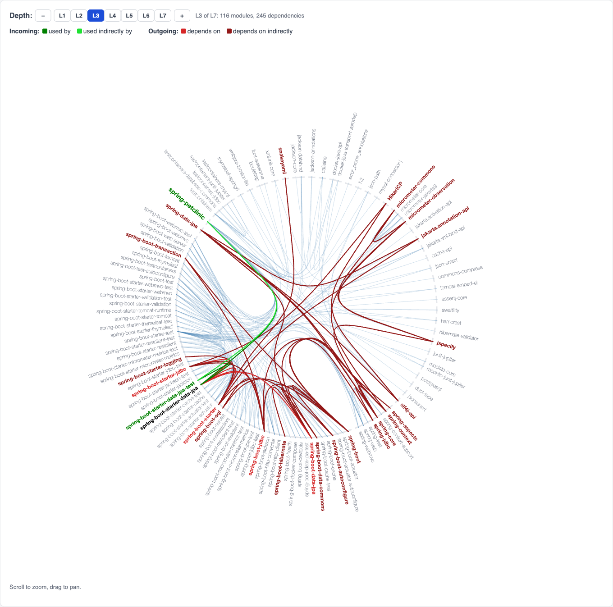
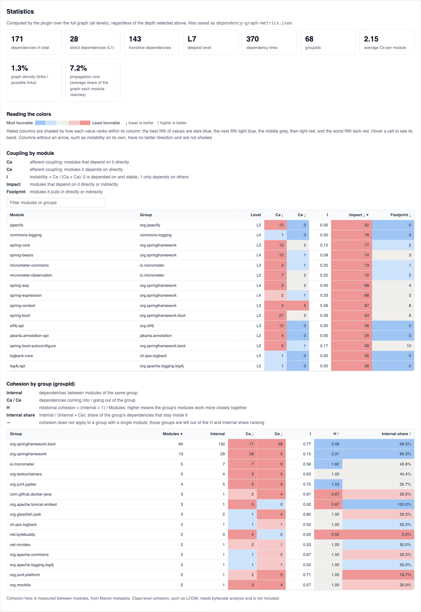

The **Dependency Graph Plugin** is now available on Maven Central. Run one command in any Maven project and it generates an interactive dependency graph, together with coupling and cohesion metrics for every module it finds.

```bash
mvn io.github.wildcraft:dependency-graph-plugin:1.0.0:generate
```

The report is written to `target/dependency-graph/index.html`. Open it in a browser; no server is needed.

## Background

Dependency analysis and resolving version conflicts in Maven builds made me look deeper into how Maven dependencies fit together. Java 9 modules then required a deep analysis to break down the jigsaw puzzle of dependencies inside the JDK. Kirk Knoernschild's *Java Application Architecture*, which explains modularity patterns, maturity models and OSGi, pushed me to build the [chart of JDK module dependencies](/2017/08/16/jdk-module-dependencies/) on this blog in 2017.

Since then, a Maven plugin that draws the same kind of chart for any Maven project has been on my backlog. It is now done, built with AI assistance.

## What the report shows

### The dependency graph

Every module sits on a ring, grouped by groupId, and each dependency is drawn as a bundled edge (D3 [hierarchical edge bundling](https://bl.ocks.org/mbostock/7607999)). Your own project's modules are shown in blue. Hover any module to trace it, using the same colors as the JDK chart:

<span style="color:green">Green</span> - **used by**: direct dependents. <br/>
<span style="color:#1ee232">Lighter green</span> - **used indirectly by**: transitive dependents. <br/>
<span style="color:red">Red</span> - **depends on**: direct dependencies. <br/>
<span style="color:#931919">Brown</span> - **depends on indirectly**: transitive dependencies. <br/>

{: style="max-width:100%; height:auto;"}

The graph includes every dependency Maven resolves, including transitive and test scope. The plugin also reads each artifact's POM, so all declared links between libraries are drawn, not only the single path Maven used to resolve them.

A **depth control** (L1, L2, L3, ...) limits the chart to the direct dependencies, then adds one level at a time. The chosen level is kept in the URL, so a shared link opens at the same depth.

### Coupling and cohesion metrics

Below the graph, the report measures the structure it has drawn:

* **Coupling per module**, following Robert C. Martin:
  * **Ca**: how many modules use it.
  * **Ce**: how many modules it uses.
  * **Instability**: I = Ce / (Ca + Ce).
  * **Impact**: everything that depends on it, directly or indirectly.
  * **Footprint**: everything it pulls in, directly or indirectly.
* **Cohesion per groupId**:
  * **Relational cohesion**: H = (R + 1) / N, where R is the number of links between the group's modules and N the number of modules.
  * **Internal share**: the fraction of the group's dependencies that stay inside the group.
* **Whole-graph figures**: density, and propagation cost, which is the average share of the graph a change can reach.

Each cell is shaded from favorable (blue) to unfavorable (red) against the rest of the project, so the outliers stand out. The tables can be sorted and filtered, and hovering a row highlights that module in the graph.

{: style="max-width:100%; height:auto;"}

These are module-level metrics computed from the dependency graph. They are not the class-level Chidamber & Kemerer metrics, which need the compiled classes.

## Multi-module builds

Run the goal once from the parent POM and the plugin produces a single report for the whole build. The modules don't need to be built or installed first. A **Module** selector redraws the chart for one module at a time, with levels counted from that module. This makes it easy to check that, for example, `domain` never reaches into `web`.

## Try it on well-known projects

The repository includes reports generated from two well-known Spring Boot projects, ready to download and open:

| Project | Dependencies | Levels | Links |
| --- | --- | --- | --- |
| [Spring Petclinic](https://github.com/spring-projects/spring-petclinic) | 171 (28 direct) | L1–L7 | 370 |
| [DDDSample](https://github.com/citerus/dddsample-core), the cargo shipping application from Eric Evans' *Domain-Driven Design* | 174 (13 direct) | L1–L5 | 380 |

Their metrics tell different stories:
* **Petclinic:** `spring-boot` is the most directly used module (Ca 21), and `jspecify` has the widest impact (92 modules depend on it).
* **DDDSample:** `slf4j-api` leads on both counts, and the Selenium test libraries form the largest group (19 modules), with a high instability of 0.94.

Downloads and screenshots are in the [project README](https://github.com/Wildcraft/depedency-graph-plugin#sample-reports).

## Getting started

Requirements: **Java 17+** and **Maven 3.9.16+**.

```bash
# from the root of any Maven project
mvn io.github.wildcraft:dependency-graph-plugin:1.0.0:generate

# optional: open at depth L2
mvn io.github.wildcraft:dependency-graph-plugin:1.0.0:generate -Ddependency.graph.depth=2
```

To use the short form `mvn dependency-graph:generate`, add the plugin group to `~/.m2/settings.xml`:

```xml
<settings>
  <pluginGroups>
    <pluginGroup>io.github.wildcraft</pluginGroup>
  </pluginGroups>
</settings>
```

Along with `index.html`, the plugin writes `dependency-graph-metrics.json`, so the same metrics can be tracked in CI over time.

## What's next

* A **package-level view** of a single module's internals, analyzed from compiled classes with `jdeps`.
* **Layer rules** for onion and hexagonal architectures, with violations highlighted in the graph.
* **JDK module dependencies** and module-path readiness for each library, closing the loop with the 2017 JDK chart.

The source is on [GitHub](https://github.com/Wildcraft/depedency-graph-plugin), and issues and pull requests are welcome.
